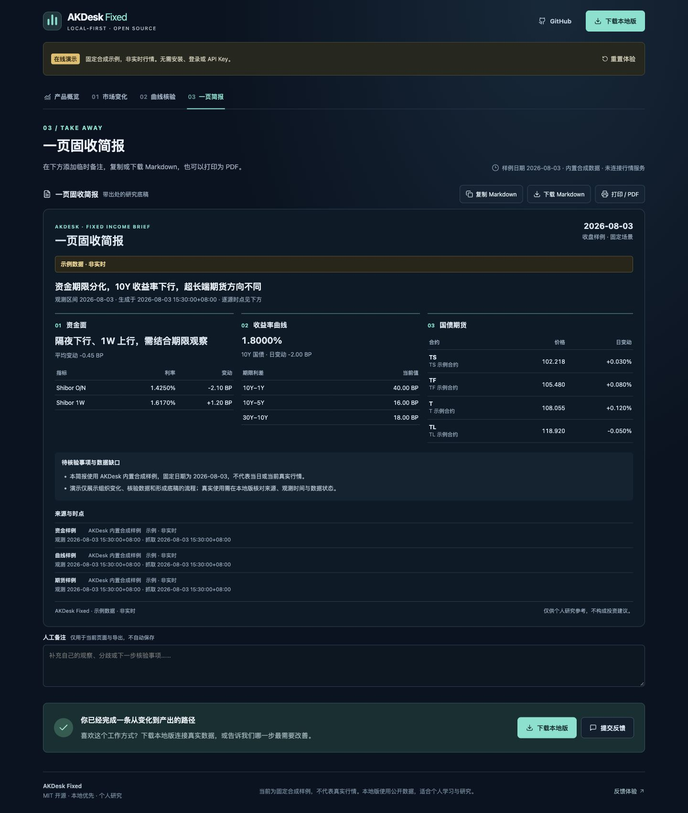

# AKDesk Fixed

把资金、曲线与国债期货的变化，整理成一页带出处的固收简报。

[](./LICENSE) [](#本地安装三步) [](https://github.com/raistlinsha-plus/akdesk-fixed/releases/latest)

**[先在线体验](https://raistlinsha-plus.github.io/akdesk-fixed/)** · **[下载本地版](https://github.com/raistlinsha-plus/akdesk-fixed/releases/latest)** · [English](./README_EN.md) · [反馈](https://github.com/raistlinsha-plus/akdesk-fixed/issues/new/choose)



先走一条路径：**查看市场变化 → 回到收益率曲线核验 → 添加备注并导出简报**。不必先了解全部模块。

在线演示使用固定 **2026-08-03 合成样例**，非实时行情；无需安装、登录或 API Key，不连接行情服务或本地后端。本地完整版保留市场、信用观察、研究项目、专题和周期复盘；业务界面目前以中文为主。

[60 秒演示视频](https://raistlinsha-plus.github.io/akdesk-fixed/akdesk-demo-60s.mp4) · [查看示例 Markdown](./docs/media/v1.1.0/示例-固收简报.md) · [可复现 AKShare 案例](./docs/examples/AKShare-一页固收简报.md)

## 本地安装三步

主要适配 Apple Silicon MacBook Air，要求 **macOS 12+、Python 3.11–3.13**。首次安装需要网络与约 1 GB 可用空间。正式包已带预构建界面，普通使用无需 Node.js、Docker 或 Rust。

1. 准备受支持的 Python。使用 Homebrew 时可执行 `brew install python@3.13`。
2. 在 [Releases](https://github.com/raistlinsha-plus/akdesk-fixed/releases/latest) 选择 `AKDesk-Fixed-v1.1.0.zip` 正式资源，核对对应 SHA-256，完整解压。
3. 双击 `start-macos.command`。启动器执行本地预检、安装锁定依赖，并打开 `http://127.0.0.1:8765`。

GitHub 自动生成的 **Source code** 压缩包用于源码查看和开发，与经过发布清单、构建资源和执行权限检查的正式 ZIP 不同；源码用户可能需要自行构建界面或恢复脚本权限。实际可下载版本与验收结果以 Release 页面和 [发布与验收记录](./docs/AKDesk-Fixed-v1.1.0-发布与验收记录.md) 为准。

macOS 阻止脚本时，可右键选择“打开”。执行权限丢失时，在项目目录运行：

```bash
chmod +x start-macos.command start-macos-demo.command stop-macos.command
```

**停止服务**：在原启动终端按 `Control+C`，或双击 `stop-macos.command`。只关闭浏览器不会停止服务。同版本已运行时，启动器会打开现有服务；端口冲突和旧版本会给出提示。

**启动遇到问题**：预检检查 Python、文件、权限、空间和证书位置；依赖失败有分类恢复提示。可独立执行 `python3 scripts/preflight.py --json`。进入应用后，打开“使用与反馈”，主动生成并预览脱敏诊断摘要，再决定是否分享；不会自动上传 Key、路径、数据库或研究正文。详细恢复步骤见 [用户手册](./docs/AKDesk-Fixed-v1.1.0-用户手册.md)。

## 能完成哪些工作

- **快速市场底稿**：查看变化、核验曲线，生成包含资金、利差、期货、出处和时间的一页简报；完整每日复盘仍保留现券、发行事件和研究工作流。
- **持续个人研究**：统一自选、证据篮、研究项目、专题、反证、任务与每周复盘，记录观点如何变化。
- **信用与跨市场观察**：信用观察 R2、外汇、宏观图表、主权比较与事件线索。
- **解释数据状态**：区分真实、缓存、过期、演示和混合来源；缺失保持为空，关键数值不足时方向待核验。

临时备注可以随简报复制、下载 Markdown 或打印/PDF，不会自动保存为研究笔记。旧归档没有逐源出处时会显示待核验。全部原有功能继续保留，详见 [产品介绍](./docs/AKDesk-Fixed-v1.1.0-产品介绍.md) 与 [完整功能手册](./docs/AKDesk-Fixed-v1.0.0-用户手册.md)。

## 四类数据源

| 数据源 | 主要用途 | 配置与边界 |
| --- | --- | --- |
| AKShare / AKTools 生态 | 中国资金、曲线、现券、国债期货、转债、发行与部分外汇 | 当前本地版使用 Python AKShare；它是公开数据访问层，不是交易所授权实时行情 |
| FRED 官方 API | 美国利率、通胀、就业、增长与发布复盘 | 用户自备 Key；观测值按请求处理，不持久化到本地数据库，研究中保存引用 |
| World Bank API v2 | 跨经济体主权结构比较 | 无需 Key；明确署名与缺失，同年度对齐，支持带状态的本地缓存 |
| GDELT DOC 2.0 | 外部事件检索与待核验线索 | 无需 Key；按需查询和缓存元数据，不抓取新闻正文，不自动判断信用风险 |

中国市场路径不需要 FRED 或 AI Key。FRED 与 AI 都是独立可选功能：用户按需提供自己的凭据；macOS 使用 Keychain 管理凭据。AI 经用户授权发送裁剪上下文，提供摘要与待核验任务，使用额度由用户自己的服务账户承担。

This product uses the FRED® API but is not endorsed or certified by the Federal Reserve Bank of St. Louis.

应用没有使用遥测或追踪 SDK。研究数据保存在本机；反馈由用户主动提交。数据缓存、凭据、AI 发送范围和备份规则详见 [用户手册](./docs/AKDesk-Fixed-v1.1.0-用户手册.md)。

## 适合谁

适合关注固收与宏观的个人研究者、AKShare/Python 使用者，以及想评估本地投研工作流的业务与科技人员。可以先用在线样例判断产出是否对自己有用，再安装完整版。

不适合作为机构生产交易、正式估值、会计核算、监管报送或风控限额的唯一依据。公开数据的时效和连续性受上游影响；产品不承诺实时行情或机构级 SLA，不构成投资建议。

## 文档与反馈

- [v1.1 产品介绍](./docs/AKDesk-Fixed-v1.1.0-产品介绍.md) · [用户手册](./docs/AKDesk-Fixed-v1.1.0-用户手册.md) · [测试用例清单](./docs/AKDesk-Fixed-v1.1.0-测试用例清单.md)
- [发布与验收记录](./docs/AKDesk-Fixed-v1.1.0-发布与验收记录.md) · [更新记录](./CHANGELOG.md) · [公开路线图](./ROADMAP.md)
- [提交功能/数据问题](https://github.com/raistlinsha-plus/akdesk-fixed/issues/new/choose) · [分享使用场景](https://github.com/raistlinsha-plus/akdesk-fixed/discussions/16)

反馈最有帮助的信息是：要完成的任务、操作步骤、预期与实际结果、应用版本和模式。请先检查截图和附件，不上传 API Key、本机数据库或未公开研究材料。

## 开发与复现

后端：

```bash
python3 -m venv .venv
.venv/bin/python -m pip install -r backend/requirements.lock -r backend/requirements-dev.txt
PYTHONPATH=backend:. .venv/bin/python -m pytest backend/tests
```

前端与独立静态演示：

```bash
cd frontend
npm ci
npm run check
npm run build:demo
npm run preview:demo
```

无需第三方依赖的固定 CLI 样例：`python3 examples/fixed_income_brief.py --output brief-example.md`。真实模式与超时说明见 [examples/README.md](./examples/README.md)。应用由 React/TypeScript/Vite、FastAPI/Python 与 SQLite 组成，完整开发流程见 [CONTRIBUTING](./CONTRIBUTING.md)。

## 许可与贡献

自有代码采用 [MIT License](./LICENSE)。第三方组件与数据分别受其原始许可、使用条款和署名要求约束；**MIT 不授予第三方行情或内容的再分发权**。参见 [第三方声明](./THIRD_PARTY_NOTICES.md)。

欢迎可复现 Bug、文档修正、适配器测试和研究案例。参与前请阅读 [贡献指南](./CONTRIBUTING.md)、[行为准则](./CODE_OF_CONDUCT.md)；敏感漏洞按 [安全政策](./SECURITY.md) 报告。
