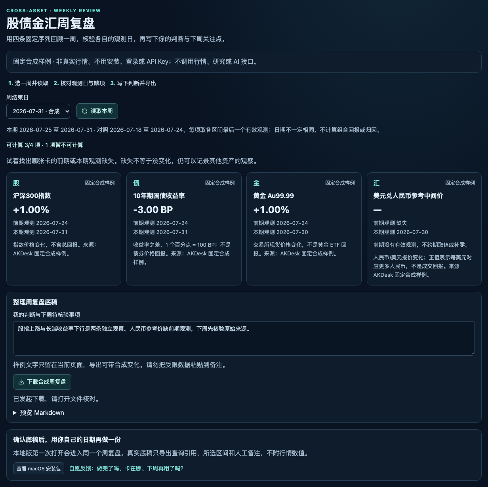

# AKDesk Fixed

**Review China's stocks, bonds, gold and FX for a week, and take away a worksheet with sources.** AKDesk is an open-source macOS research tool with a fixed-income focus.

**[Try the weekly review](https://raistlinsha-plus.github.io/akdesk-fixed/#/cross-asset-week)** · [See the finished Markdown](./docs/examples/AKDesk-v1.4.2-股债金汇周复盘样例.md) · [One-page fixed-income brief](https://raistlinsha-plus.github.io/akdesk-fixed/#/brief) · [Download for macOS](https://github.com/raistlinsha-plus/akdesk-fixed/releases/latest) · [中文](./README.md)



**Pick a week → check observation dates and gaps → write a judgment → export.** The demo uses fixed synthetic data. It requires no install, login or API key. If Pages is inaccessible, open the Markdown example above. The app's UI is primarily Chinese.

**v1.4.2:** New local sessions without an entry preference open the same task. The four real series cover CSI 300, China's 10-year government bond yield, Au99.99 and the USD/CNY reference midpoint. A missing series does not prevent export: real worksheets include the selected date range, query references and your note, not quote values. [First-use and validation guide](./docs/AKDesk-Fixed-v1.4.2-使用与验收指南.md) (Chinese).

[](./LICENSE) [](#local-installation)

## Local installation

Targets Apple Silicon MacBook Air, **macOS 12+ and Python 3.11–3.13**. Initial installation needs network access and about 1 GB of free space. The official package includes a prebuilt UI; normal use requires no Node.js, Docker or Rust.

macOS 12+ is a compatibility target, not a certification of every OS release. See the [validation guide](./docs/AKDesk-Fixed-v1.4.2-使用与验收指南.md).

1. Install a supported Python; with Homebrew, use `brew install python@3.13`.
2. Download the versioned `AKDesk-Fixed-vX.Y.Z.zip` and `SHA256SUMS` from [GitHub Releases](https://github.com/raistlinsha-plus/akdesk-fixed/releases/latest). Verify SHA-256 and unzip the whole package.
3. Double-click `start-macos.command`. It runs local checks, installs locked dependencies and opens `http://127.0.0.1:8765`.

GitHub's automatic **Source code** archive is for source inspection and development. It is different from the installation ZIP checked for release manifest, built assets and executable permissions. The Releases page determines public availability.

If macOS blocks the launcher, right-click and choose Open. To restore executable permissions:

```bash
chmod +x start-macos.command start-macos-demo.command stop-macos.command
```

Stop with `Control+C` in the original launcher terminal or use `stop-macos.command` from the same installation. Closing the browser does not stop the service. Use the same `AKDESK_PORT` setting for start and stop if customized.

The launcher checks Python, release files, directory permissions, disk space and certificate locations, with recovery guidance for installation failures. Run `python3 scripts/preflight.py --json` for an offline check. In the app, “使用与反馈” (Usage and feedback) lets you explicitly generate, preview, copy or download a redacted diagnostic summary. It does not upload automatically or include keys, personal paths, raw errors, databases or research content.

## What is included

- A one-page brief for funding, the 10Y yield, curve spreads and CGB futures, with gaps and per-source timestamps. The full daily review remains available.
- Watchlists, evidence collection, research projects, topics, counter-evidence, tasks and weekly reviews.
- Credit Watch R2, FX, macro charts, sovereign comparisons and external event leads.
- Small gold/index observation and four explicitly selected ETF daily-history examples; no whole-market ETF scans, NAV premium/discount or total-return calculation.
- A weekly cross-asset review for four fixed series, with independent reads, a return from the source page, an in-memory draft and reference-only export in real mode.
- Explicit sample/mixed/unknown provenance, cache status and missing values. Missing inputs do not become zero or a market-direction conclusion.

Temporary notes can accompany the brief's Markdown and print/PDF output but are not automatically saved as research notes. See the [current user manual](./docs/AKDesk-Fixed-v1.4.1-用户手册.md) (Chinese) and [data boundaries](./DATA_USAGE.md).

## Data sources and optional services

| Source | Purpose | Setup and boundaries |
| --- | --- | --- |
| AKShare / AKTools ecosystem | China funding, curves, bonds, CGB futures, convertibles, issuance and selected FX | This app currently uses Python AKShare; public-data access layer, not an exchange-authorized live feed |
| FRED official API | US rates, inflation, jobs, growth and release reviews | User-owned key; request-scoped observations, stored research references rather than observation values |
| World Bank API v2 | Cross-country structural comparisons | No key; attribution, same-year alignment, explicit gaps and cache state |
| GDELT DOC 2.0 | External event leads | No key; on-demand metadata only, no article-body collection or automatic credit judgment |

The China-market path needs no FRED or AI key. FRED and AI are optional; users supply their own credentials, managed through macOS Keychain. AI sends trimmed context after user authorization, with usage charged against the user's own provider account.

This product uses the FRED® API but is not endorsed or certified by the Federal Reserve Bank of St. Louis.

The app includes no usage-telemetry or tracking SDK. Research stays local, and feedback is submitted by the user.

## Intended use

For individual fixed-income/macro researchers, AKShare/Python users and people evaluating local research workflows. Try the sample output before installing.

Not a sole source for production trading, accounting valuation, regulatory reporting or risk-limit decisions. Upstream availability and timeliness vary; no real-time or institutional SLA is promised. Not investment advice.

## Documentation and feedback

- Current: [First-use and validation guide](./docs/AKDesk-Fixed-v1.4.2-使用与验收指南.md) · [Full v1.4.1 manual](./docs/AKDesk-Fixed-v1.4.1-用户手册.md) (Chinese)
- [Fixed-income video](https://raistlinsha-plus.github.io/akdesk-fixed/akdesk-demo-60s.mp4) · [ETF exercise](https://raistlinsha-plus.github.io/akdesk-fixed/#/start) · [Reproducible AKShare example](./docs/examples/AKShare-一页固收简报.md)
- [Changelog](./CHANGELOG.md) · [Roadmap](./ROADMAP.md)
- [Report a bug/data issue](https://github.com/raistlinsha-plus/akdesk-fixed/issues/new/choose) · [Describe your workflow](https://github.com/raistlinsha-plus/akdesk-fixed/discussions/16)

Include the task, steps, expected/actual behavior, version and mode. Do not upload API keys, local databases or confidential research.

## Development and reproduction

Backend:

```bash
python3 -m venv .venv
.venv/bin/python -m pip install -r backend/requirements.lock -r backend/requirements-dev.txt
PYTHONPATH=backend:. .venv/bin/python -m pytest backend/tests
```

Frontend and static demo:

```bash
cd frontend
npm ci
npm run check
npm run build:demo
npm run preview:demo
```

Standard-library example: `python3 examples/fixed_income_brief.py --output brief-example.md`. Optional live mode is explained in [examples/README.md](./examples/README.md). The stack is React/TypeScript/Vite, FastAPI/Python and SQLite.

## License and contributions

Original code is [MIT licensed](./LICENSE). Third-party dependencies and data retain their own terms and attribution requirements; **MIT grants no redistribution rights for third-party data or content**. See [third-party notices](./THIRD_PARTY_NOTICES.md).

Reproducible bugs, documentation fixes, adapter tests and research cases are welcome. Read [CONTRIBUTING](./CONTRIBUTING.md), the [Code of Conduct](./CODE_OF_CONDUCT.md) and the [Security Policy](./SECURITY.md).
